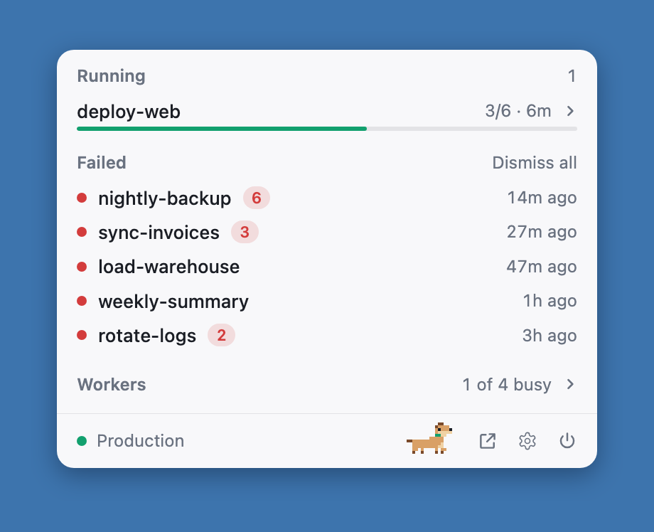

# Dagpeek

See what your [Dagu](https://dagu.sh) server is doing without opening Dagu. A free menu bar app for Mac, by [Ailio](https://ailio.ca). Windows is on the way.

It shows what's running, what's queued, what failed since you last looked, and how far each run has got, across one Dagu server or all of them.



## Install

```sh
brew install --cask ailio-technologies-inc/tap/dagpeek
```

Or download it from [dagpeek.com](https://dagpeek.com). It needs macOS 13 or later.

## Use it

Click the menu bar icon and add your server's URL. If your server needs a sign-in, Dagpeek keeps the password or token in your Keychain.

The app also installs a command that uses the same servers:

```sh
dagpeek status [--json]
dagpeek runs
dagpeek watch <dag>
```

## Privacy and control

Dagpeek talks to the servers you add, its update feed, and Google Analytics for one anonymous count a day: a random install id, the app version and the OS. It never includes your servers, DAGs or runs. Turn it off in Settings. There's no account.

It only reads from Dagu until you turn on actions in Settings. Then you can stop, retry or dequeue runs, and each one asks you to confirm.

## Build it

You need Rust, Node and pnpm.

```sh
pnpm install
cargo test --workspace
pnpm tauri dev
```

## License

MIT. Dagpeek is an independent app and isn't affiliated with the Dagu project.
